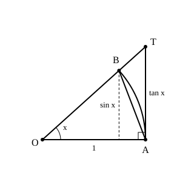

## 「近づく」とはどういうことか

$\frac{1}{10}$、$\frac{1}{100}$、$\frac{1}{1000}$……分母を大きくしていくと、この分数は0に近づいていきます。でも、どんなに分母を大きくしても、$\frac{1}{n}$ はちょうど0にはなりません。このように「限りなく近づいていく先の値」を**極限**といいます。

アキレスと亀のパラドックスを考えてみましょう。アキレスは亀の10倍の速さで走り、亀は100m先からスタートします。

アキレスが100m進む間に、亀はその10分の1である10m先に進みます。アキレスがその10mを進む間に、亀はさらに1m先に進みます。この繰り返しを考えると、亀は常にわずかに先にいるように見え、アキレスは永遠に追いつけないように思えます。

しかしアキレスが走る距離の合計を計算すると $100 + 10 + 1 + 0.1 + \ldots$ となり、これは限りなく $111.1\ldots$ mに近づいて有限の距離に収まるため、アキレスは亀に追いつくことができます。**無限個足しても有限の値になる**——これが極限の力です。パラドックスは、「無限回の操作を行う」ことと「無限の時間がかかる」ことを同一視した誤りから生じた見かけ上のものであり、実際には各ステップにかかる時間の合計もまた有限であるため、無限回の操作は有限の時間内に終わるのです。

---

## 数列の極限

数列 $\{a_n\}$ が値 $L$ に**収束する**とは、$n$ を大きくするにつれて $a_n$ が $L$ に限りなく近づくことです。

$$\lim_{n \to \infty} a_n = L$$

収束しない場合は「**発散する**」といいます。$a_n = n^2$ のように限りなく大きくなる場合は $\lim_{n\to\infty} a_n = \infty$ と書きます。

**例**：

$$\lim_{n \to \infty} \frac{1}{n} = 0, \quad \lim_{n \to \infty} \frac{n^2+1}{2n^2-3} = \frac{1}{2}$$

最後の例は、分子・分母を $n^2$ で割ると $\dfrac{1 + 1/n^2}{2 - 3/n^2} \to \dfrac{1}{2}$ とわかります。

---

## 関数の極限

$x$ を $a$ に近づけたとき $f(x)$ が $L$ に近づくことを

$$\lim_{x \to a} f(x) = L$$

と書きます。「$x = a$ を代入する」のではなく「$a$ に近づける」という点が重要で、$x=a$ で $f$ が定義されていなくても極限は存在しえます。

**例**：$f(x) = \dfrac{x^2 - 1}{x - 1}$ は $x = 1$ で定義されませんが、

$$\frac{x^2-1}{x-1} = \frac{(x-1)(x+1)}{x-1} = x+1 \quad (x \neq 1)$$

なので $\lim_{x \to 1} \dfrac{x^2-1}{x-1} = 2$。

極限が存在しない場合もあります。**例**：$f(x)=\dfrac{|x|}{x}$ の $x\to0$ での極限を考える。$x>0$側から近づけると$f(x)=1$に近づき、$x<0$側から近づけると$f(x)=-1$に近づきます。近づき方によって近づく先の値が異なるため、$\displaystyle\lim_{x\to0}\dfrac{|x|}{x}$ は存在しません。

---

## 極限の計算規則

数列・関数のいずれの極限についても、同様の計算規則が成り立ちます。ここでは数列の極限を例に説明します（関数の場合も同様の規則が成り立ちます）。$\displaystyle\lim_{n\to\infty} a_n = L$、$\displaystyle\lim_{n\to\infty} b_n = M$ のとき：

$$\lim (a_n + b_n) = L + M, \quad \lim (a_n b_n) = LM, \quad \lim \frac{a_n}{b_n} = \frac{L}{M} \; (M \neq 0)$$

**例**：$\displaystyle\lim_{n\to\infty}\left(3 + \frac{2}{n}\right)$ を求める。和の規則より

$$\lim_{n\to\infty}\left(3+\frac{2}{n}\right) = \lim_{n\to\infty} 3 + \lim_{n\to\infty}\frac{2}{n} = 3 + 0 = 3$$

（$\displaystyle\lim_{n\to\infty}\frac{n^2+1}{2n^2-3}=\frac12$ という先ほどの例も、分子・分母を $n^2$ で割った $\dfrac{1+1/n^2}{2-3/n^2}$ に対してこの和・商の規則を繰り返し適用することで成り立っています。）

---

## 連続性

**定義**：$\displaystyle\lim_{x\to a} f(x) = f(a)$ が成り立つとき、$f$ は $x = a$ で**連続**であるといいます。グラフでいうと、その点で線がつながっている（切れ目がない）ということです。

**例**：$f(x)=\dfrac{|x|}{x}$（$x\neq0$で定義）は、$x>0$では$f(x)=1$、$x<0$では$f(x)=-1$となり、近づき方によって近づく先の値が異なるため$x\to0$での極限が存在しません。極限そのものが存在しない以上、$x=0$では連続になりえません（$x\neq0$では連続です）。このように、極限が存在しない点やグラフが切れている点では、関数は連続ではありません。

---

## 重要な極限

$$\lim_{n \to \infty} r^n = 0 \quad (|r| < 1)$$

$|r|<1$のとき、$|r|^n$は掛けるたびに絶対値が小さくなっていくため、$n$を大きくすると限りなく0に近づきます。

$$\lim_{x \to 0} \frac{\sin x}{x} = 1 \quad \text{（ラジアン単位）}$$

**例題**：$\displaystyle\lim_{n\to\infty} \frac{3n^2 + 2n - 1}{n^2 - 5}$ を求める。分子・分母を $n^2$ で割ると $\dfrac{3 + 2/n - 1/n^2}{1 - 5/n^2} \to 3$。

---

## はさみうちの原理

極限が直接計算しづらいとき、その数列（関数）を上下から挟む2つの数列（関数）の極限が一致すれば、間の極限も同じ値に定まります。

**はさみうちの原理（数列版）**：$a_n \leq b_n \leq c_n$ が成り立ち、$\displaystyle\lim_{n\to\infty} a_n = \lim_{n\to\infty} c_n = L$ ならば、$\displaystyle\lim_{n\to\infty} b_n = L$。

**はさみうちの原理（関数版）**：$a$ の近くで $f(x) \leq g(x) \leq h(x)$ が成り立ち、$\displaystyle\lim_{x\to a} f(x) = \lim_{x\to a} h(x) = L$ ならば、$\displaystyle\lim_{x\to a} g(x) = L$。

> [!NOTE]
> 上で挙げた $\displaystyle\lim_{x\to0}\frac{\sin x}{x}=1$ も、はさみうちの原理（関数版）で示せます。単位円上で中心角 $x$（$0 < x < \pi/2$）の扇形を考えます。まず、扇形に内接する三角形の面積は $\frac12\sin x$ です。次に、扇形自体の面積は $\frac12 x$ です。さらに、扇形を含む直角三角形の面積は $\frac12\tan x$ です。
>
> 
>
> これら3つの面積の大小関係から $\sin x < x < \tan x$ が成り立ちます。各辺を $\sin x>0$ で割ると $1 < \dfrac{x}{\sin x} < \dfrac{1}{\cos x}$、逆数をとって $\cos x < \dfrac{\sin x}{x} < 1$ が得られます。$x\to0$ で $\cos x \to 1$ なので、はさみうちの原理より $\dfrac{\sin x}{x}\to1$ となります。また $\dfrac{\sin x}{x}$ は偶関数です（$\dfrac{\sin(-x)}{-x} = \dfrac{-\sin x}{-x} = \dfrac{\sin x}{x}$）。したがって、$0<x<\pi/2$ で示した議論を $x \to -x$ と置き換えることで $-\pi/2 < x < 0$ の場合にもそのまま適用でき、左右どちらから近づけても同じ極限 $1$ に収束することが確かめられます。

**例**：$\displaystyle\lim_{n\to\infty} \frac{\sin n}{n}$ を求める。$-1 \leq \sin n \leq 1$ より $-\dfrac1n \leq \dfrac{\sin n}{n} \leq \dfrac1n$。両端が0に収束するので、はさみうちの原理より極限も0。

---

## まとめ

極限とは「ある値に限りなく近づいていく先」のことです。数列でも関数でも定義でき、和・積・商について計算規則が成り立ちます。連続性は「極限と実際の値が一致する」性質として定義され、微分・積分の土台になります。

---

## 関連ページ

- [微分](derivatives.md)
- [極限の厳密な定義](../../bachelor/analysis/epsilon-delta.md)
