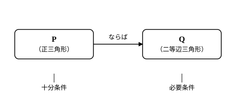

## 「ならば」は一方通行

「雨が降るならば、地面が濡れる」——これは日常の感覚では正しいといえます。では、逆の「地面が濡れているならば、雨が降った」は正しいでしょうか。晴れていても散水車が通れば地面は濡れるので、逆は正しくありません。

このように、「$P$ ならば $Q$」が成り立っても、「$Q$ ならば $P$」は成り立つとは限りません。

---

## 命題と論理記号

真偽が定まる文を**命題**といいます。命題 $P$, $Q$ から次の複合命題が作れます。

| 記号 | 読み方 | 意味 |
|------|--------|------|
| $\neg P$ | $P$ でない | $P$ の否定 |
| $P \wedge Q$ | $P$ かつ $Q$ | 両方が真 |
| $P \vee Q$ | $P$ または $Q$ | 少なくとも一方が真 |
| $P \Rightarrow Q$ | $P$ ならば $Q$ | $P$ が真のとき $Q$ も真 |
| $P \Leftrightarrow Q$ | $P$ と $Q$ は同値 | $P \Rightarrow Q$ かつ $Q \Rightarrow P$ |

表の $P \Rightarrow Q$ の意味は、$P$ が真の場合についてだけ述べています。そのため、$P \Rightarrow Q$ が偽になるのは、$P$ が真で $Q$ が偽の場合だけです。$P$ が偽の場合は、$Q$ の真偽によらず $P \Rightarrow Q$ は真とします。たとえば「雨が降るならば、地面が濡れる」は、雨が降らなかった日には、地面が濡れていてもいなくても破られたことになりません。

---

## 十分条件・必要条件・同値

「$x$ は正三角形である」のように、$x$ に何を当てはめるかによって真偽が変わる文を**条件**といいます。$x$ についての条件を $P(x)$ のように書きます。$P(x)$ が真になる $x$ を「$P$ を満たす $x$」といいます。条件を扱うときは、$x$ が動く範囲をあらかじめ決めておきます。この範囲を全体集合 $U$ とします。範囲によって結論が変わることがあるからです。たとえば「$x^2 = 1$ ならば $x = 1$」は、$U$ が自然数全体なら正しいですが、$U$ が整数全体なら $x = -1$ のときに崩れます。

条件 $P(x)$, $Q(x)$ について、$U$ のどの $x$ についても $P(x) \Rightarrow Q(x)$ が真であることを、「$P \Rightarrow Q$ が成り立つ」と表します。「命題と論理記号」の節で見たとおり、$P(x) \Rightarrow Q(x)$ が偽になるのは、$P(x)$ が真で $Q(x)$ が偽のときだけです。$P$ を満たさない $x$ では $P(x) \Rightarrow Q(x)$ は真なので、そのような $x$ は「$P \Rightarrow Q$ が成り立つ」ことを崩しません。したがって「$P \Rightarrow Q$ が成り立つ」とは、$P$ を満たす $x$ がすべて $Q$ も満たすということです。つまり、条件についての「$P \Rightarrow Q$ が成り立つ」は、個々の $x$ についての $P(x) \Rightarrow Q(x)$ を、$U$ のすべての $x$ についてまとめた主張です。

$P \Rightarrow Q$ が成り立つとき、$P$ は $Q$ の**十分条件**、$Q$ は $P$ の**必要条件**といいます。$P$ を満たせば、それだけで $Q$ を満たすことが保証されるので、$P$ は「十分」な条件です。もし $Q$ を満たさない $x$ が $P$ を満たしたら、$P(x)$ が真で $Q(x)$ が偽となり、$P \Rightarrow Q$ が成り立つことに反します。そのため $Q$ を満たさない $x$ は $P$ も満たさず、$Q$ は $P$ にとって「必要」な条件です。

**例**：三角形 $x$ について、$P(x)$：$x$ は正三角形、$Q(x)$：$x$ は二等辺三角形、とします。正三角形はどれも二等辺三角形なので、$P \Rightarrow Q$ が成り立ちます。したがって、「正三角形」は「二等辺三角形」であるための十分条件、「二等辺三角形」は「正三角形」であるための必要条件です。

逆の「二等辺三角形ならば、正三角形」は成り立ちません（2辺だけ等しい三角形が反例）。

$P \Rightarrow Q$ と $Q \Rightarrow P$ の両方が成り立つとき、$P$ と $Q$ は**同値**（$P \Leftrightarrow Q$）といい、$P$ は $Q$ の**必要十分条件**です。

$P$ が $Q$ の何条件かは、$P \Rightarrow Q$ と $Q \Rightarrow P$ をそれぞれ確かめて判定します。成り立たない向きは、反例を $1$ つ挙げれば示せます。$P \Rightarrow Q$ だけが成り立てば、$P$ は $Q$ の十分条件ですが、必要条件ではありません。$Q \Rightarrow P$ だけが成り立てば、$P$ は $Q$ の必要条件ですが、十分条件ではありません。両方が成り立てば、$P$ は $Q$ の必要十分条件です。どちらも成り立たなければ、$P$ は $Q$ の必要条件でも十分条件でもありません。

三角形 $x$ についての例で確かめます。「$x$ は正三角形」は「$x$ は二等辺三角形」の十分条件ですが、必要条件ではありません。「$x$ は正三角形」と「$x$ の $3$ つの角がすべて等しい」は、どちらの向きも成り立つので、互いに必要十分条件です。「$x$ は直角三角形」と「$x$ は二等辺三角形」は、$3$ 辺の長さが $3, 4, 5$ の三角形と正三角形がそれぞれ反例になるので、必要条件でも十分条件でもありません。

---

## 逆・裏・対偶

$P$, $Q$ が命題の場合も条件の場合も、$P \Rightarrow Q$ から次の $3$ つが作れます。

| 名前 | 式 | $P \Rightarrow Q$ との関係 |
|------|----|----|
| 逆 | $Q \Rightarrow P$ | 一般に同値でない |
| 裏 | $\neg P \Rightarrow \neg Q$ | 一般に同値でない |
| **対偶** | $\neg Q \Rightarrow \neg P$ | **常に同値** |

逆・裏がいずれも同値でないことは、冒頭の例で確認できます。逆「地面が濡れているならば雨が降った」は成り立ちません（散水車の反例）。裏「雨が降っていないならば地面は濡れていない」も同様に成り立ちません（雨が降っていなくても、散水車が通れば地面は濡れるため）。

**なぜ対偶は元の命題と同値か**：まず $P$, $Q$ が命題の場合を考えます。「命題と論理記号」の節の表の直後で見たとおり、$P \Rightarrow Q$ が偽になるのは、$P$ が真で $Q$ が偽のときだけです。同じ決め方を $\neg Q \Rightarrow \neg P$ に当てはめると、これが偽になるのは、$\neg Q$ が真で $\neg P$ が偽のときだけです。

$\neg Q$ が真とは、$Q$ が偽であることです。$\neg P$ が偽とは、$P$ が真であることです。したがって $\neg Q \Rightarrow \neg P$ が偽になるのも、$P$ が真で $Q$ が偽のときだけです。偽になる場合が同じなので、$P \Rightarrow Q$ と $\neg Q \Rightarrow \neg P$ の真偽は常に一致します。

条件 $P(x)$, $Q(x)$ の場合も、各 $x$ について $P(x) \Rightarrow Q(x)$ と $\neg Q(x) \Rightarrow \neg P(x)$ の真偽は一致します。そのため、「$P \Rightarrow Q$ が成り立つ」ことと「$\neg Q \Rightarrow \neg P$ が成り立つ」ことは、一方が成り立てば他方も成り立ちます。

直接「$P$ ならば $Q$」を示しにくいとき、対偶「$\neg Q$ ならば $\neg P$」を示すことで証明できます。

> [!NOTE]
> $\square$は証明の終わりを表す記号です。

**例題**：整数 $n$ について、「$n^2$ が偶数ならば $n$ は偶数」を証明する。$P(n)$：$n^2$ は偶数、$Q(n)$：$n$ は偶数、とする。対偶は「$n$ が偶数でないならば $n^2$ は偶数でない」である。整数は偶数か奇数のどちらかなので、これは「$n$ が奇数ならば $n^2$ は奇数」と同じである。奇数は $2$ で割ると $1$ 余る整数なので、整数 $k$ を用いて $n = 2k+1$ と表せる。このとき $n^2 = 4k^2+4k+1 = 2(2k^2+2k)+1$ で、$2k^2+2k$ は整数なので $n^2$ は奇数である。$\square$

---

## 背理法

「$P$ が成り立たない」と仮定して矛盾を導き、「$P$ は成り立つ」と結論する証明法です。矛盾とは、ある命題 $R$ と、その否定 $\neg R$ がともに成り立つことです。$\neg P$ から正しく推論して矛盾が導かれたなら、「$\neg P$ ならば『$R$ かつ $\neg R$』」は真です。ところが『$R$ かつ $\neg R$』は常に偽です。「命題と論理記号」の節で見たとおり、「ならば」が偽になるのは仮定が真で結論が偽のときだけなので、この「ならば」が真であるためには、仮定 $\neg P$ が偽でなければなりません。$\neg P$ が偽であることは $P$ が真であることと同じなので、$P$ が成り立つと結論できます。

**例題**：$\sqrt{2}$ が無理数であることを証明する。

この例題で示したい命題 $P$ は「$\sqrt{2}$ は無理数である」です。無理数とは有理数でない実数のことなので、$\neg P$ は「$\sqrt{2}$ は有理数である」です。そこで、$\sqrt{2}$ が有理数であると仮定します。

有理数は、分母が $0$ でない整数どうしの分数で表せます。約分を続ければ、分子と分母を互いに素な形にできます。互いに素とは、$1$ 以外に正の公約数を持たないことです。よって、互いに素な整数 $p, q$（$q \neq 0$）を用いて $\sqrt{2} = \dfrac{p}{q}$ と書けます。両辺を $2$ 乗して分母を払うと $p^2 = 2q^2$ です。

$p^2$ が偶数なので $p$ も偶数です（奇数の2乗は奇数になるため、$p$が奇数だと$p^2$も奇数になり矛盾します）。

$p=2m$ とおくと $p^2 = 2q^2$ に代入して $4m^2 = 2q^2$、すなわち $q^2 = 2m^2$ となり $q$ も偶数です（$q^2$ が偶数なので $q$ も偶数、これも奇数の2乗は奇数になるためです）。$p, q$ はともに偶数なので、$1$ 以外の正の公約数 $2$ を持ちます。つまり「$p, q$ は互いに素でない」ことが導かれました。これは、最初に $p, q$ を互いに素に選んだこと（「$p, q$ は互いに素である」）と矛盾します。したがって「$\sqrt{2}$ は有理数である」という仮定は誤りで、$\sqrt{2}$ は無理数です。$\square$

---

## 集合との対応

「$P \Rightarrow Q$ が成り立つ」ことは、集合の言葉でも表せます。条件 $P(x)$ を満たす $x$ 全体の集合を $A = \{x \in U \mid P(x)\}$、条件 $Q(x)$ を満たす $x$ 全体の集合を $B = \{x \in U \mid Q(x)\}$ とすると、次が成り立ちます。

$$P \Rightarrow Q \iff A \subseteq B$$

ここで $\subseteq$ は、等号を含まない真部分集合を表す $\subset$ とは異なり、$A = B$ となる場合も含む点に注意してください。

同値 $P \Leftrightarrow Q$ は $A = B$ に対応します。

---

## まとめ

「ならば」は一方向で、$P \Rightarrow Q$ のとき $P$ は $Q$ の十分条件、$Q$ は $P$ の必要条件です。対偶は元の命題と常に同値なので、証明の言い換えに使えます。背理法は「成り立たないと仮定して矛盾を導く」証明法です。

---

## 関連ページ

- [証明法](proofs.md)
