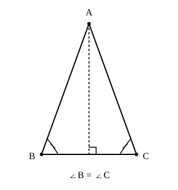
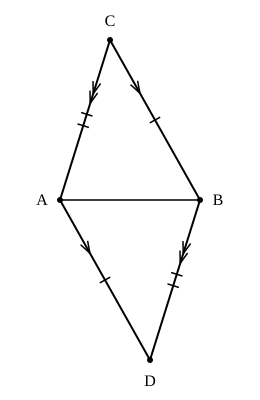
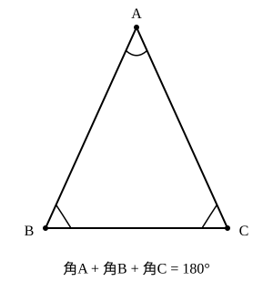

## 三角形の種類

3本の線分で囲まれた形が**三角形**です。三角形にも、辺と頂点があります。

3つの角のうち1つが90度になっている三角形を**直角三角形**といいます。

2つの辺の長さが等しい三角形を**二等辺三角形**といいます。3つの辺の長さがすべて等しい三角形を**正三角形**といいます。

二等辺三角形では、等しい2辺が交わる頂点にできる角を**頂角**といいます。頂角の向かい側にある辺を**底辺**といいます。底辺の両端にできる角を**底角**といいます。

等しい2辺がぴったり重なるように、頂角の頂点を通る線で二等辺三角形を半分に折ってみます。等しい2辺は長さも同じなので、底辺の両端の点どうしも重なり、2つの底角どうしがぴったり重なります。このことから、2つの底角の大きさが等しいことが確かめられます。

---

## 三角形の面積

二等辺三角形では頂角の向かい側の辺を底辺と呼びましたが、面積を考えるときはどんな三角形でも、3つの辺のうちどれを基準に選んでもかまいません。基準に選んだ辺を**底辺**と呼びます。

三角形の面積は「底辺×高さ÷2」で求められます。ここでの「高さ」は、底辺に垂直な方向で測った、底辺から向かい合う頂点までの距離のことです。

$$S = \frac{1}{2} \times \text{底辺} \times \text{高さ}$$

この公式がなぜ成り立つのかを、三角形を2つ組み合わせて確かめてみましょう。ここでは、向かい合う頂点から底辺に垂直に下ろした線が、底辺の内側に入るように底辺を選びます。下の図では、三角形ABDの辺ABを底辺とし、頂点Dから底辺に垂直に下ろした線DEが高さです。

三角形ABDと形も大きさもまったく同じ（ぴったり重なる）三角形を、もう1つ用意します。そして、底辺以外の辺を1つ選びます。ここでは辺BDを選びます。用意した三角形を、辺BDの真ん中の点を中心にして180度回転させ、辺BDどうしがぴったり重なるように三角形ABDと組み合わせます。すると、回転させた三角形は三角形CDBの位置にきて、四角形ABCDができます。

回転させた三角形CDBの辺DCは、もとの三角形の辺ABが移ったものです。同じように、辺CBはもとの辺DAが移ったものです。そのため、四角形の向かい合う辺ABとDC、ADとBCは、それぞれ長さが等しくなります。

また、180度回転させると辺の向きは逆向きになりますが、傾きは変わりません。そのため、辺ABとDC、辺ADとBCは、図の矢印のようにそれぞれ平行になります。

もとの三角形の底辺ABは、四角形の1辺になっています。もとの三角形の頂点Dは、ABと平行な向かいの辺DCの上にあります。そのため、平行な2辺ABとDCの間の距離は、三角形ABDの高さDEと同じです。

次に、頂点Dから底辺ABに垂直に下ろした線DEで、三角形AEDを切り取ります。これを、辺ADが辺BCにぴったり重なるように右へ移すと、三角形BFCの位置にきます。すると、四角形ABCDは、たてがDE、よこがEFの長方形EFCDに形を変えます。よこのEFは、三角形AEDをABの長さだけ右へ移したので、底辺ABと同じ長さです。

長方形の面積は「たて×よこ」で求められます（[広さ・かさ](../numbers/measurement-area.md)を参照）。ここでは、たてが高さ、よこが底辺にあたるので、長方形EFCDの面積は「底辺×高さ」です。切り取って移しただけで、部分を足したり取り除いたりはしていないので、四角形ABCDの面積も長方形と同じ「底辺×高さ」です。

四角形ABCDは、ぴったり重なる三角形2つでできています。そのため、三角形ABDの面積はその半分の「底辺×高さ÷2」になります。

> [!NOTE]
> 選んだ底辺によっては、向かい合う頂点から垂直に下ろした線が底辺の外に出ることがあります。そのときは、底辺をまっすぐ延ばした直線まで垂直に測った距離を高さとします。この場合も面積は「底辺×高さ÷2」で求められますが、上の切り取り方はそのままでは使えません。

---

## 3つの角の大きさの和

どんな三角形でも、3つの角の大きさを全部合わせるといつでも180度になります。三角形の形や大きさによらず成り立つ性質です。実際に紙の三角形を作り、3つの角を切り取って頂点を1点に集めてみると、3つの角がちょうど一直線（180度）になることを確かめられます。

---

## まとめ

三角形は3本の線分で囲まれた最も基本的な図形です。角度によって直角三角形、辺の長さによって二等辺三角形・正三角形といった種類に分けられ、面積は「底辺×高さ÷2」で求められます。また、3つの角の大きさの和はいつでも180度になります。

---

## 関連ページ

- [四角形](shapes-quadrilateral.md)
- [合同](shapes-congruence.md)
